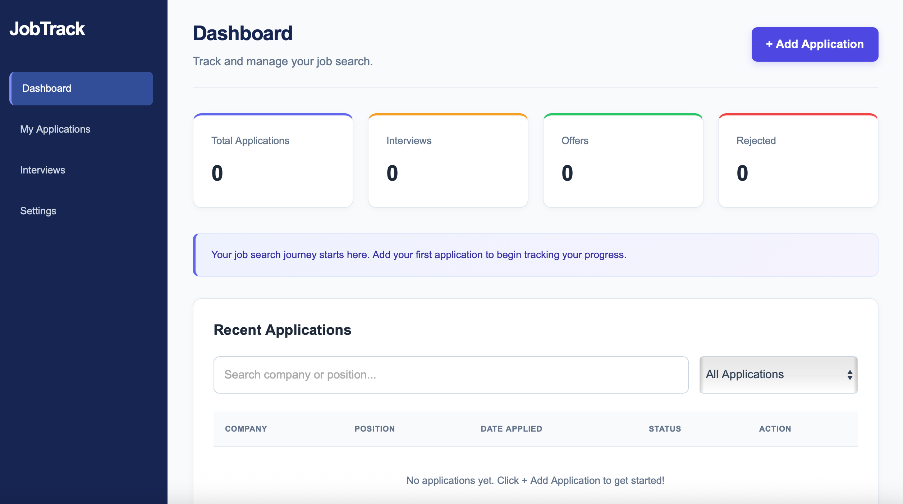

# Job Application Tracker 💼

A web-based application designed to help job seekers organize, manage, and track their job applications in one place.

## 🌐 Live Demo

[Visit Job Application Tracker](https://prismasharma.github.io/job-application-tracker/)

## 📸 Screenshot

## ✨ Features

- Add new job applications.
- Edit existing applications.
- Delete applications with confirmation.
- Track application statuses.
- Search and filter job applications.
- Dashboard statistics.
- Empty-state messages and notifications.
- Persistent data storage using Local Storage.

## 🛠️ Technologies Used

- HTML5
- CSS3
- JavaScript
- Browser Local Storage

## 🚀 Getting Started

1. Clone this repository:

   `git clone https://github.com/prismasharma/job-application-tracker.git`

2. Open the project folder.
3. Open `index.html` in your browser.

## 📂 Project Structure

- `index.html` – Application structure.
- `style.css` – Styling and layout.
- `script.js` – Application functionality.
- `README.md` – Project documentation.

## 🎯 Project Purpose

Built as a hands-on project to strengthen my frontend development skills and practice JavaScript, DOM manipulation, event handling, and CRUD operations.

## 👩‍💻 Developer

**Prisma Sharma**

[GitHub Profile](https://github.com/prismasharma)
